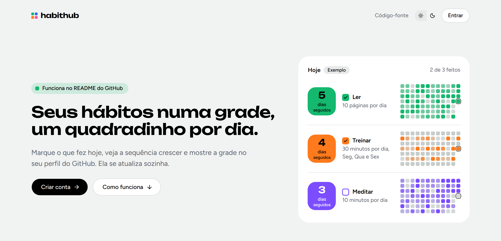
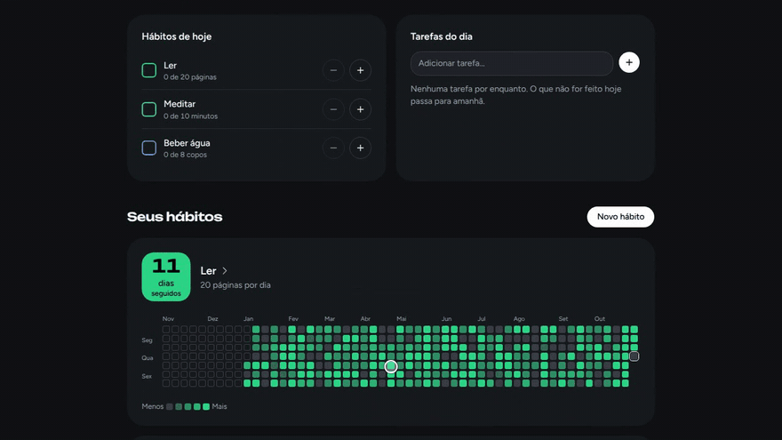
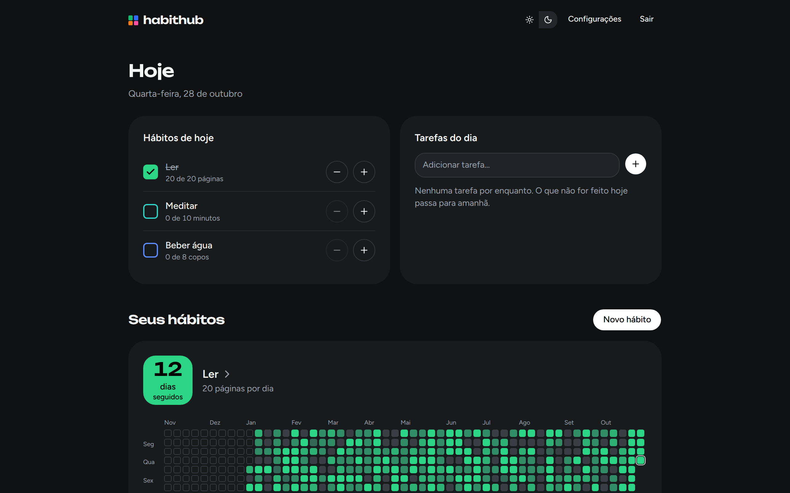
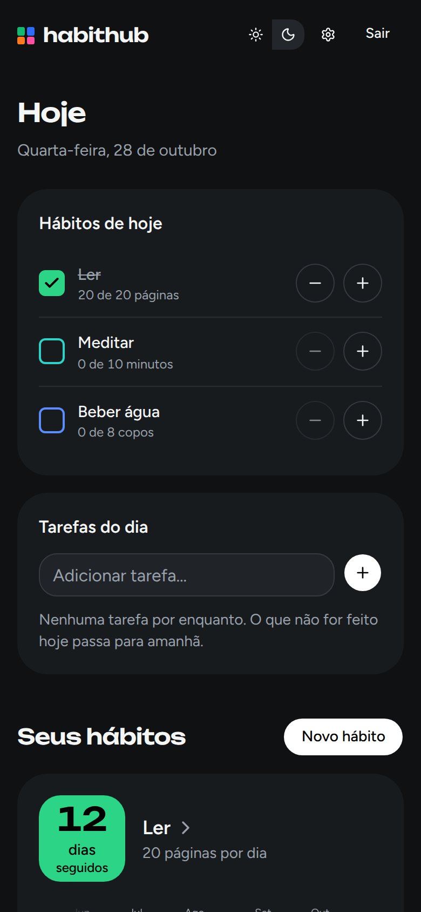
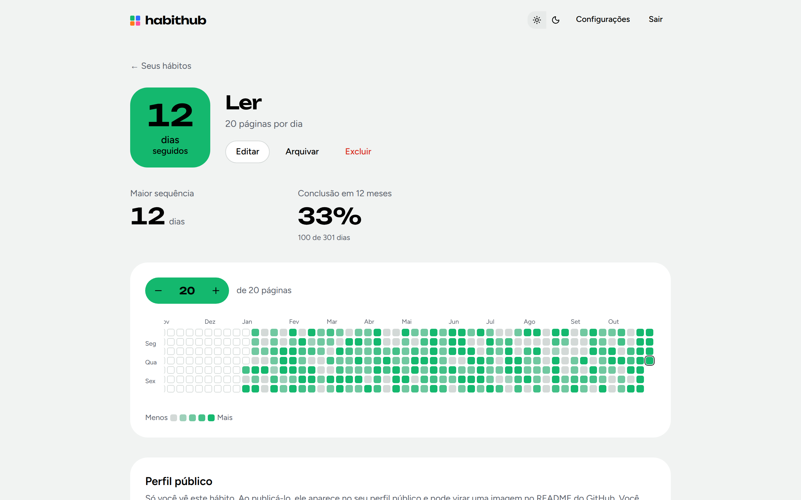
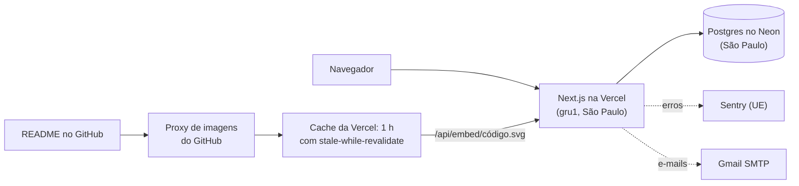
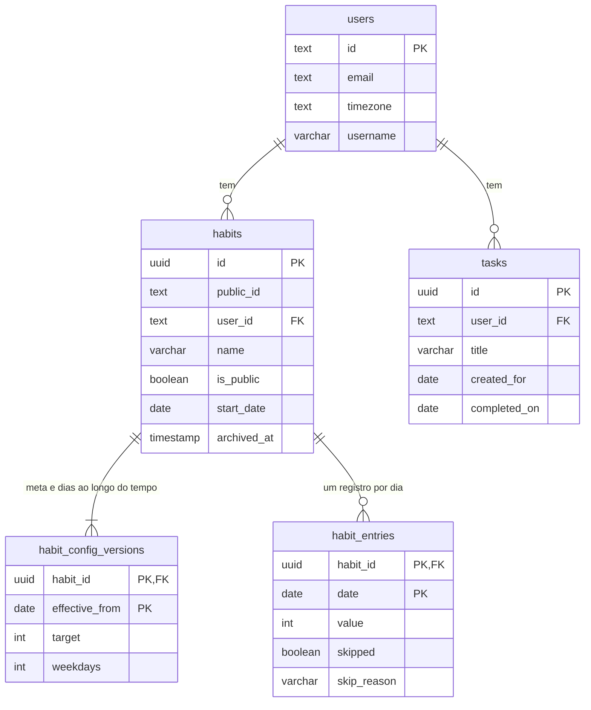

<h1 align="center">
  <picture>
    <source media="(prefers-color-scheme: dark)" srcset="docs/screenshots/logo-dark.png">
    
  </picture>
</h1>

<p align="center"><strong>Seus hábitos numa grade, um quadradinho por dia.</strong></p>

<p align="center">
  <a href="https://habithub-app.vercel.app">App no ar</a> ·
  <a href="https://habithub-app.vercel.app/u/luanfzll">Meu perfil público</a> ·
  <a href="docs/decisoes.md">Decisões de produto e arquitetura</a> ·
  <a href="https://www.linkedin.com/in/luanfleal/">LinkedIn</a>
</p>

<p align="center">
  <a href="https://github.com/luanfzll/habit-hub/actions/workflows/ci.yml"></a>
  <a href="LICENSE"></a>
  <a href="https://habithub-app.vercel.app"></a>
</p>

Tracker de hábitos em que cada hábito vira uma grade de quadradinhos, um por dia, como o gráfico de contribuições do GitHub. A grade de um hábito pode ir para o README do seu perfil no GitHub e se atualiza sozinha.

Uso o app no dia a dia desde outubro de 2026.

<picture>
  <source media="(prefers-color-scheme: dark)" srcset="docs/screenshots/inicio-escuro.png">
  
</picture>

## O que dá para fazer

- **Marcar o dia com um toque.** O painel "Hoje" mostra só os hábitos agendados para hoje. Metas em quantidade (20 páginas, 8 copos) têm +1 e −1, e as tarefas avulsas que não forem feitas passam para o dia seguinte.
- **Ver o ano inteiro.** Cada hábito tem uma grade de 12 meses com tons de intensidade, dias fora da agenda listrados e dias pulados, com um motivo opcional, que não quebram a sequência.
- **Acompanhar a constância:** sequência atual, maior sequência e taxa de conclusão.
- **Mostrar no GitHub.** Até 2 hábitos podem ir para um perfil público (`/u/<nome>`) e virar uma imagem SVG para o README, nos temas claro e escuro, que se atualiza sozinha.
- **Cuidar da conta e dos dados:** confirmação de e-mail, recuperação de senha, troca de e-mail e de senha, exportação em JSON e exclusão da conta.
- **Usar em qualquer tela,** no tema claro ou escuro.



<table>
  <tr>
    <td width="500">
      <br>
      <sub>Painel: o que fazer hoje e a grade de cada hábito</sub>
    </td>
    <td rowspan="2" width="270" valign="top">
      <br>
      <sub>No celular</sub>
    </td>
  </tr>
  <tr>
    <td width="500">
      <br>
      <sub>Página do hábito, no tema claro</sub>
    </td>
  </tr>
</table>

## A grade no README

A imagem abaixo é a grade real do meu hábito de academia. Ela vem do próprio app, se atualiza sozinha (com até 1 hora de atraso) e segue o tema claro ou escuro de quem lê. O código para colar é gerado na página do hábito, no botão "Copiar código para o README". O perfil público fica em [habithub-app.vercel.app/u/luanfzll](https://habithub-app.vercel.app/u/luanfzll).

<a href="https://habithub-app.vercel.app/u/luanfzll">
  <picture>
    <source media="(prefers-color-scheme: dark)" srcset="https://habithub-app.vercel.app/api/embed/kvq8i6kx3g.svg?theme=dark">
    
  </picture>
</a>

## Destaques técnicos

- **Uma função, dois desenhos.** `buildGrid`, em TypeScript puro, calcula a grade. O app a desenha em HTML e a imagem do README em SVG, então os dois nunca discordam. [`grid.ts`](src/domain/grid.ts) · [`embed-svg.ts`](src/lib/embed-svg.ts) · testes: [`grid.test.ts`](src/domain/grid.test.ts), [`embed-svg.test.ts`](src/lib/embed-svg.test.ts)
- **Datas sem fuso escondido.** Um dia é sempre uma data de calendário (`"2026-10-15"`), e "hoje" vem do fuso salvo no perfil. Os testes rodam nos fusos de São Paulo e de Tóquio para pegar erros de um dia. [`calendar-date.ts`](src/domain/calendar-date.ts) · teste: [`calendar-date.test.ts`](src/domain/calendar-date.test.ts)
- **Metas com histórico.** Mudar a meta ou os dias da semana cria uma versão nova a partir de hoje, sem reescrever o passado. [`habit-config.ts`](src/domain/habit-config.ts) · teste: [`day-state.test.ts`](src/domain/day-state.test.ts)
- **Imagem feita para o README.** Cache de 1 hora com `stale-while-revalidate` (poupa o banco gratuito), a mesma imagem "Hábito indisponível" para hábito privado, arquivado ou inexistente, e uma CSP que impede o SVG de executar qualquer coisa. [`route.ts`](src/app/api/embed/[file]/route.ts)
- **Next.js 16 com Cache Components.** Casca estática com os dados em streaming, Server Actions com atualização otimista e "desfazer", e uma página inicial estática com os exemplos desenhados no navegador. [`next.config.ts`](next.config.ts) · [`use-habit-entries.tsx`](src/components/habit/use-habit-entries.tsx)
- **Privacidade desde o modelo.** Hábitos privados por padrão, motivos de dias pulados nunca públicos, Sentry com coleta de dados restrita, e e-mails enviados depois da resposta, para não revelar se uma conta existe. [`public/service.ts`](src/server/public/service.ts) · [`sentry-options.ts`](src/lib/sentry-options.ts) · teste: [`service.int.test.ts`](src/server/public/service.int.test.ts)
- **Segurança revisada.** Cabeçalhos de segurança e CSP em todas as respostas, senha atual exigida para trocar o e-mail, varredura com o OWASP ZAP sem falhas graves. [`next.config.ts`](next.config.ts) · [`auth.ts`](src/server/auth.ts) · teste: [`security.spec.ts`](e2e/security.spec.ts)
- **Banco que se defende.** As regras do domínio também valem no Postgres, com restrições `CHECK` nas migrações (o Prisma não tem sintaxe para elas). [`migration.sql`](prisma/migrations/20261013170127_init/migration.sql)

## Decisões

Algumas trocas que fiz, entre as registradas em [docs/decisoes.md](docs/decisoes.md):

- **E-mails pelo Gmail, sem domínio próprio.** É grátis e funciona sem domínio; em troca, o limite é de uns 500 e-mails por dia e alguns podem cair no spam.
- **Sem login pelo GitHub na v1.** Só encurtaria o login de quem já tem conta e exigiria um app OAuth, regras de vínculo e testes de um login externo.
- **CSP sem nonces.** Nonces deixariam todas as páginas dinâmicas; sem eles, a página inicial continua estática, e os scripts inline do Next e do tema seguem permitidos.

## Arquitetura



O modelo de dados central (sem as tabelas da autenticação), a partir do [`schema.prisma`](prisma/schema.prisma):



Um registro não aponta para uma versão: para cada dia, vale a versão do mesmo hábito com o maior `effective_from` que não passa da data do registro.

## Stack

| Camada                | Ferramentas                                                                                                                  |
| --------------------- | ---------------------------------------------------------------------------------------------------------------------------- |
| Front-end             | Next.js 16 (App Router, Cache Components) · React 19 · TypeScript · Tailwind CSS 4 · shadcn/ui (Base UI) · next-intl (pt-BR) |
| Back-end              | Server Actions e Route Handlers do Next.js · Better Auth · Zod · Nodemailer (Gmail SMTP)                                     |
| Banco                 | Postgres 17 · Prisma 7                                                                                                       |
| Testes                | Vitest · Playwright · axe                                                                                                    |
| Infra/Observabilidade | Vercel · Neon · Sentry · Docker (Postgres local) · GitHub Actions                                                            |

## Rodando localmente

Requisitos: Node 24 (veja `.nvmrc`) e Docker.

```bash
cp .env.example .env          # depois gere o segredo: openssl rand -base64 32
docker compose up -d          # Postgres 17 na porta 5434
npm install
npm run db:migrate            # aplica as migrações no banco local
npm run db:seed               # opcional: conta de exemplo com meses de histórico
npm run dev                   # http://localhost:3100
```

A conta de exemplo criada pelo seed é `dev@habithub.local`, com a senha `senha-de-dev-123`.

Essa conta só existe no seu banco local: o seed se recusa a rodar em produção (`NODE_ENV` ou `VERCEL_ENV` igual a `production`) ou com um `DATABASE_URL` que não aponte para esta máquina ([`seed.ts`](prisma/seed.ts)).

Em desenvolvimento, os e-mails não são enviados: o texto e os links aparecem no terminal e ficam salvos em `.outbox/` (`EMAIL_TRANSPORT=console`).

As imagens deste README saem da conta de exemplo, com `npm run readme:media` ([`readme-media.ts`](scripts/readme-media.ts)).

## Testes

| Comando                                                       | O que roda                                                                                               |
| ------------------------------------------------------------- | -------------------------------------------------------------------------------------------------------- |
| `npm run test:unit`                                           | Regras de domínio (datas, estados do dia, sequências, grade), executadas nos fusos de São Paulo e Tóquio |
| `npm run test:integration`                                    | Serviços contra um Postgres de verdade (banco `habithub_test`), também em dois fusos                     |
| `npm run test:e2e`                                            | Fluxos completos no navegador (desktop e celular) com verificação de acessibilidade (axe)                |
| `npm run lint` · `npm run typecheck` · `npm run format:check` | Qualidade estática                                                                                       |

A CI ([`ci.yml`](.github/workflows/ci.yml)) roda tudo isso em cada pull request e em cada push na `main`.

## Deploy

Cada merge na `main` publica sozinho na Vercel. Antes do build, um script cria uma cópia de backup do banco no Neon e aplica as migrações ([`migrate.ts`](scripts/deploy/migrate.ts)). O passo a passo e as variáveis de ambiente estão em [docs/deploy.md](docs/deploy.md).

## Organização

| Pasta             | O que tem                                                                    |
| ----------------- | ---------------------------------------------------------------------------- |
| `src/domain/`     | Regras puras em TypeScript, sem Next nem banco: datas, estados do dia, grade |
| `src/server/`     | Banco, autenticação, e-mails, serviços e Server Actions                      |
| `src/lib/`        | Código do servidor e do navegador: paleta, imagem SVG, exemplos              |
| `src/components/` | Interface: `habit/` (grade, cartão, menu do dia), `home/` (exemplos)         |
| `src/app/`        | Rotas: página inicial, `(auth)`, `(app)`, `(public)` e `api/`                |
| `messages/`       | Todos os textos da interface, só em pt-BR por enquanto                       |
| `prisma/`         | Esquema, migrações (com as restrições `CHECK`) e seed local                  |
| `scripts/`        | Backup e migrações do deploy, e as imagens do README                         |
| `e2e/`            | Testes Playwright                                                            |
| `docs/`           | Decisões, deploy e capturas de tela                                          |

### Convenções

- Um dia é sempre um `CalendarDate`, nunca um `Date`; a conversão para o Prisma fica só em [`db-dates.ts`](src/server/db-dates.ts).
- "Hoje" vem de `userToday`, com o fuso do perfil ([`session.ts`](src/server/session.ts)); só os exemplos da página inicial usam o do navegador.
- Todo texto da interface, inclusive os e-mails e a privacidade, fica em [`pt-BR.json`](messages/pt-BR.json).
- As cores de cada hábito saem de [`palette.ts`](src/lib/palette.ts), com contraste mínimo testado.
- Os e-mails passam pela interface `EmailSender` ([`email.ts`](src/server/email.ts)); trocar de provedor é mexer só nela.

## Próximos passos

- Versão em inglês.
- Lembretes e notificações.
- Diminuir o atraso da imagem do README.

## Limitações conhecidas

- Interface só em pt-BR.
- A imagem do README pode levar até 1 hora para mostrar um registro novo; o proxy de imagens do GitHub pode guardá-la por mais tempo.
- Os e-mails saem de uma conta Gmail: uns 500 por dia, e alguns podem cair no spam.

## Licença

[MIT](LICENSE)

## Autor

Luan Leal · [LinkedIn](https://www.linkedin.com/in/luanfleal/) · [GitHub](https://github.com/luanfzll)
