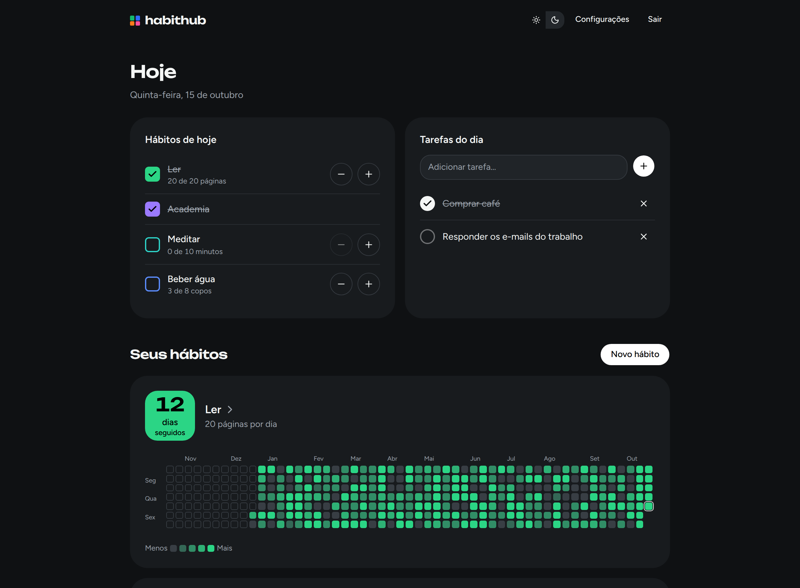
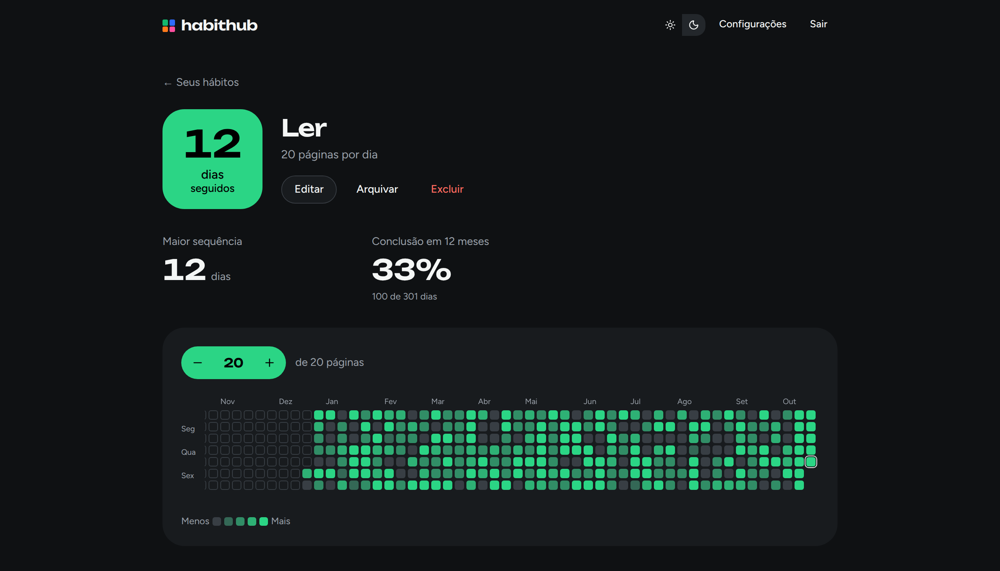
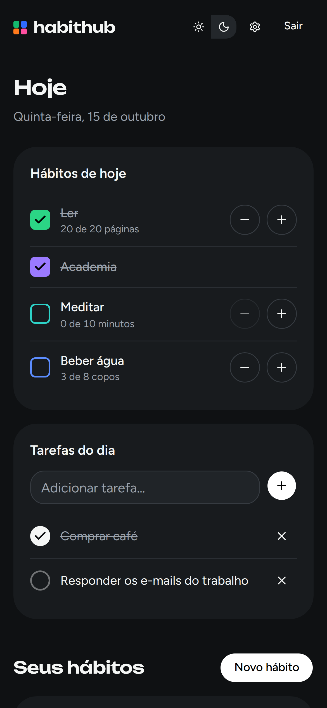

# HabitHub

Tracker de hábitos em que cada hábito vira uma grade de quadradinhos, um por dia, como o gráfico de contribuições do GitHub. A grade de um hábito pode ir para o README do seu perfil no GitHub e se atualiza sozinha.

**[habithub-app.vercel.app](https://habithub-app.vercel.app)** · [Decisões de produto e arquitetura](docs/decisoes.md) · Projeto de portfólio de Luan Leal


## O que dá para fazer

- **Marcar o dia com um toque.** O painel "Hoje" mostra só os hábitos agendados para hoje. Metas em quantidade (20 páginas, 8 copos) têm +1 e −1, e as tarefas avulsas que não forem feitas passam para o dia seguinte.
- **Ver o ano inteiro.** Cada hábito tem uma grade de 12 meses com tons de intensidade, dias fora da agenda listrados e dias pulados, com um motivo opcional, que não quebram a sequência.
- **Acompanhar a constância:** sequência atual, maior sequência e taxa de conclusão.
- **Mostrar no GitHub.** Até 2 hábitos podem ir para um perfil público (`/u/<nome>`) e virar uma imagem SVG para o README, nos temas claro e escuro, que se atualiza sozinha.
- **Cuidar da conta e dos dados:** confirmação de e-mail, recuperação de senha, troca de e-mail e de senha, exportação em JSON e exclusão da conta.
- **Usar em qualquer tela,** no tema claro ou escuro.

<p>
  
  
</p>
<p align="center">
  
</p>

## Destaques técnicos

- **Uma função, dois desenhos.** `buildGrid`, em TypeScript puro, calcula a grade. O app a desenha em HTML e a rota `/api/embed/<código>.svg` a desenha em SVG, então os dois nunca discordam.
- **Datas sem fuso escondido.** Um dia é sempre `"2026-10-15"`, e "hoje" vem do fuso salvo no perfil. Os testes rodam nos fusos de São Paulo e de Tóquio.
- **Metas com histórico.** Mudar a meta ou os dias da semana cria uma versão nova a partir de hoje, sem reescrever o passado.
- **Imagem feita para o README.** Cache de 1 hora com `stale-while-revalidate` (poupa o banco gratuito), a mesma imagem "Hábito indisponível" para hábito privado, arquivado ou inexistente, e uma CSP que impede o SVG de executar qualquer coisa.
- **Next.js 16 com Cache Components.** Casca estática com os dados em streaming, Server Actions com atualização otimista e "desfazer", e uma página inicial estática com os exemplos desenhados no navegador.
- **Privacidade desde o modelo.** Hábitos privados por padrão, motivos de dias pulados nunca públicos, Sentry com coleta de dados restrita, e e-mails enviados depois da resposta, para não revelar se uma conta existe.
- **Banco que se defende.** Restrições `CHECK` nas migrações e uma cópia de backup no Neon antes de cada migração em produção.

## Stack

Next.js 16 (App Router, Cache Components) · React 19 · TypeScript · Postgres 17 · Prisma 7 · Better Auth · next-intl (pt-BR) · Tailwind CSS 4 + shadcn/ui (Base UI) · Vitest · Playwright

## Rodando localmente

Requisitos: Node 24 (veja `.nvmrc`) e Docker.

```bash
cp .env.example .env          # depois gere o segredo: openssl rand -base64 32
docker compose up -d          # Postgres 17 na porta 5434
npm install
npm run db:migrate            # aplica as migrações no banco local
npm run db:seed               # opcional: conta de exemplo com meses de histórico
npm run dev                   # http://localhost:3100
```

A conta de exemplo criada pelo seed é `dev@habithub.local`, com a senha `senha-de-dev-123`.

Em desenvolvimento, os e-mails não são enviados: o texto e os links aparecem no terminal e ficam salvos em `.outbox/` (`EMAIL_TRANSPORT=console`).

## Deploy

O app roda na Vercel (funções em São Paulo), com o banco no Neon e os erros no Sentry. Cada merge na `main` publica sozinho: antes do build, um script cria uma cópia de backup do banco e aplica as migrações. O passo a passo e as variáveis de ambiente estão em [docs/deploy.md](docs/deploy.md).

## Testes

| Comando                                                       | O que roda                                                                                               |
| ------------------------------------------------------------- | -------------------------------------------------------------------------------------------------------- |
| `npm run test:unit`                                           | Regras de domínio (datas, estados do dia, sequências, grade), executadas nos fusos de São Paulo e Tóquio |
| `npm run test:integration`                                    | Serviços contra um Postgres de verdade (banco `habithub_test`), também em dois fusos                     |
| `npm run test:e2e`                                            | Fluxos completos no navegador (desktop e celular) com verificação de acessibilidade (axe)                |
| `npm run lint` · `npm run typecheck` · `npm run format:check` | Qualidade estática                                                                                       |

A CI (`.github/workflows/ci.yml`) roda tudo isso em cada pull request.

## Organização

```
src/
  domain/          regras puras em TypeScript, sem Next nem banco (datas, estados do dia, sequências, grade)
  server/          banco, autenticação, e-mails, serviços e Server Actions
  lib/             código usado no servidor e no navegador (paleta, imagem SVG, exemplos, formatos)
  components/      interface (habit/ = grade, cartão e menu do dia; home/ = exemplos da página inicial)
  app/             rotas: página inicial, (auth) entrar e cadastro, (app) painel, hábitos e configurações,
                   (public) perfil público e privacidade, api/ imagem do README e exportação
  i18n/, messages/ textos da interface (só pt-BR por enquanto)
prisma/            esquema, migrações (com as restrições CHECK do domínio) e seed local
scripts/deploy/    backup no Neon e migrações antes de cada deploy
e2e/               testes Playwright
docs/              decisões, deploy e capturas de tela
```

Algumas escolhas que valem conhecer antes de mexer no código:

- **Um dia é sempre um `CalendarDate` (`"2026-10-15"`)**, nunca um `Date`. A conversão para o formato do Prisma acontece só em `src/server/db-dates.ts`.
- **"Hoje" vem do fuso salvo no perfil** (`userToday`), nunca do navegador. A exceção são os exemplos da página inicial, que usam o "hoje" de quem visita.
- **Meta e agenda têm versões** (`habit_config_versions`). Uma mudança vale a partir de hoje e não reescreve o passado.
- **A mesma função (`buildGrid`) calcula a grade** para o app (HTML) e para a imagem do README (SVG).
- **Todo texto da interface está em `messages/pt-BR.json`**, inclusive os e-mails e a página de privacidade.

## Licença

[MIT](LICENSE)
